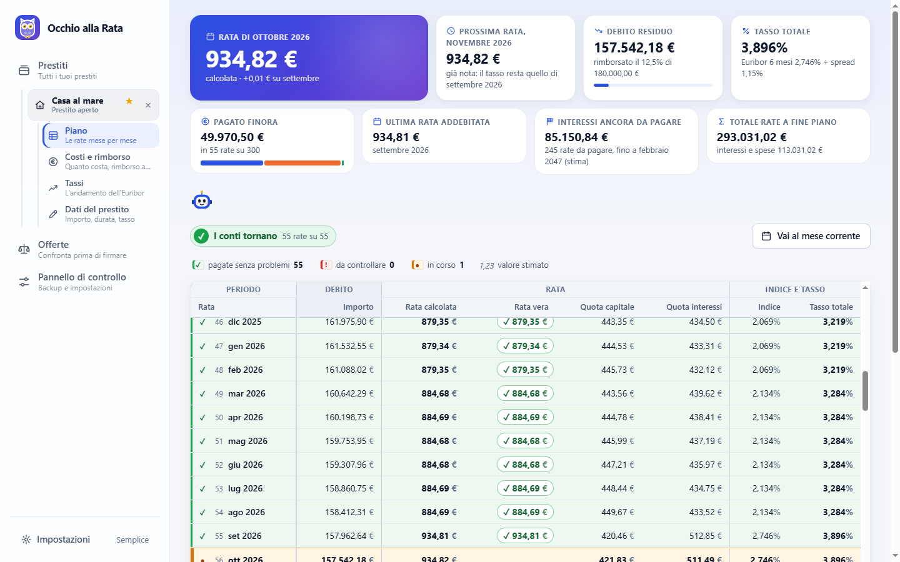
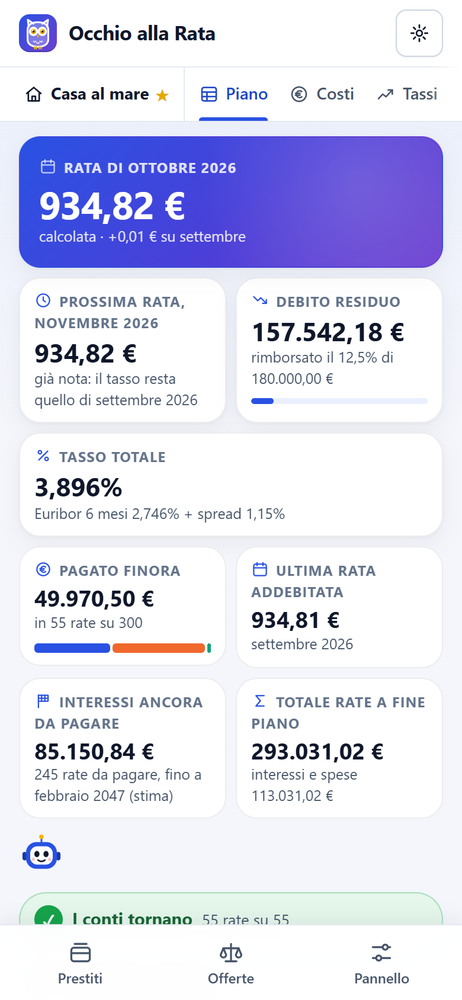
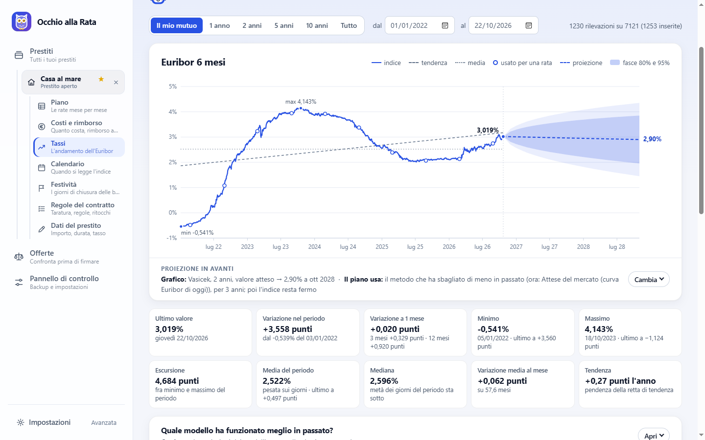
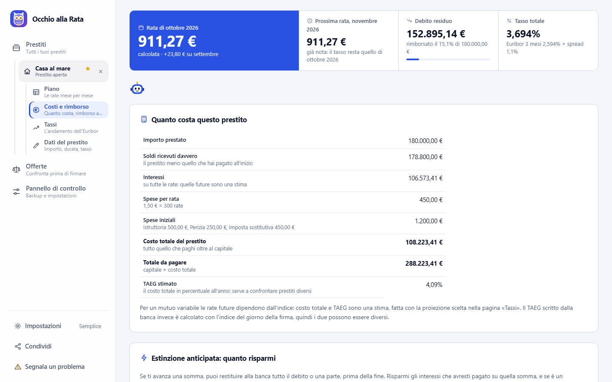
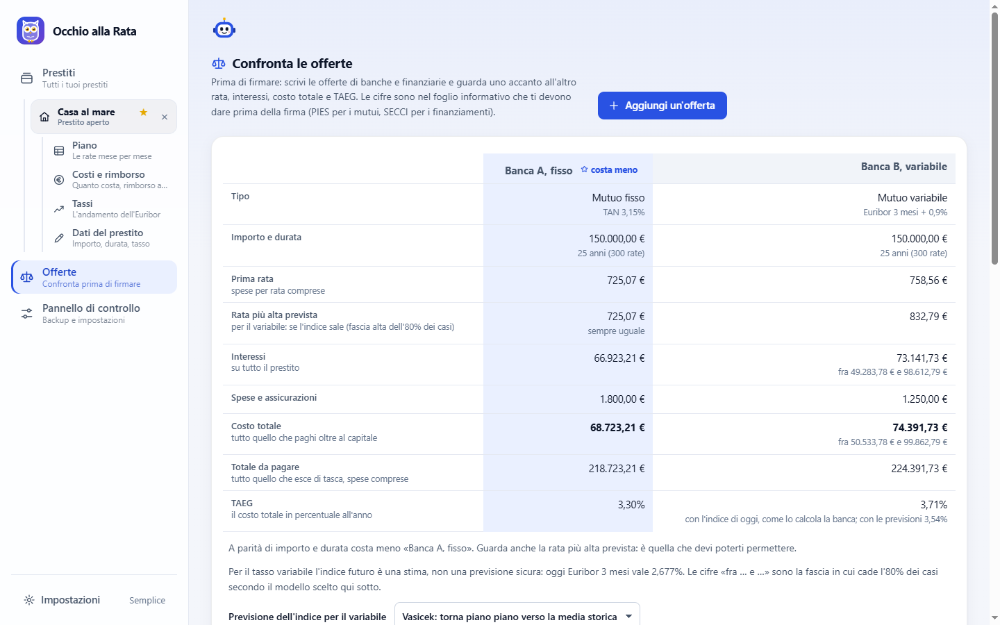
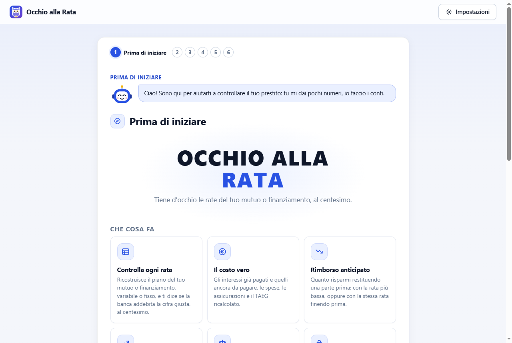
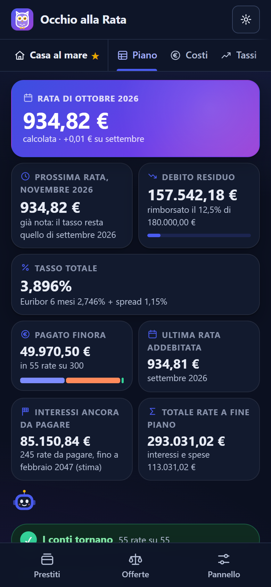
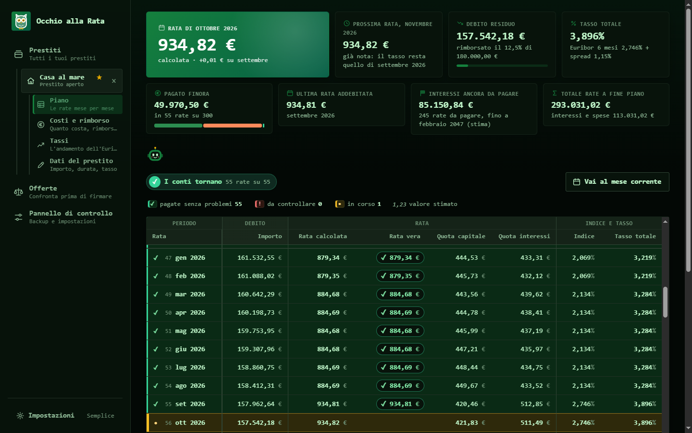

<p align="center"></p>

<h1 align="center">Occhio alla Rata</h1>

<p align="center"><strong>La banca ti addebita la rata giusta? Controllalo al centesimo.</strong><br>
Mutui a tasso variabile o fisso e finanziamenti: il piano rata per rata, il costo vero, il rimborso anticipato e il confronto delle offerte prima di firmare.</p>

<p align="center">
  <a href="https://alessandrosallam-sys.github.io/occhio-alla-rata/"><strong>Apri l'app</strong></a> ·
  <a href="#come-si-usa">Come si usa</a> ·
  <a href="#domande-frequenti">Domande frequenti</a> ·
  <a href="VERSIONI.md">Novità</a> ·
  <a href="docs/progetto-generale.md">Documentazione</a> ·
  <a href="CONTRIBUTING.md">Contribuire</a>
</p>

<p align="center">Gratis · codice aperto · nessun account · funziona anche senza connessione · i dati restano sul tuo dispositivo</p>

<p align="center">
  
  &nbsp;
  
</p>

## Perché

Con un mutuo a tasso variabile la rata cambia quasi ogni mese, e controllarla a mano è difficile: dipende dall'Euribor letto in un giorno preciso, da come si contano i giorni, da come si restituisce il capitale. Le banche sbagliano di rado, ma succede, e la maggior parte delle persone non ha modo di accorgersene.

Occhio alla Rata parte da quello che hai sull'estratto conto: scrivi alcune rate già pagate, e il programma ricava da solo il resto (indice, spread, spese, regole del contratto) finché le rate tornano al centesimo. Da lì ricostruisce tutto il piano, rata per rata.

## Che cosa fa

- **Controlla ogni rata.** Confronta la rata addebitata con quella calcolata: verde se torna, rossa se no, con la differenza.
- **Capisce il contratto da solo.** Bastano importo, durata, data della prima rata e qualche rata pagata. Se le rate non bastano, chiede solo il dato che manca e spiega dove trovarlo.
- **Dice quando si saprà la prossima rata.** Nel variabile, il giorno in cui la banca legge l'indice.
- **Calcola il costo vero.** Interessi pagati e da pagare, spese, assicurazioni e TAEG, confrontato con quello del contratto.
- **Stima le rate future.** Previsioni dell'Euribor con più modelli statistici: di base usa quello che negli anni passati ha sbagliato di meno.
- **Simula il rimborso anticipato.** Quanto risparmi rimborsando tutto o una parte, con penali e costi restituiti secondo la legge italiana.
- **Confronta le offerte.** Prima di firmare: rata, interessi, costo totale e TAEG uno accanto all'altro.
- **Segue più prestiti insieme.** Mutuo, auto, prestito personale, con i totali del mese.
- **Si prova prima, con degli esempi.** «Prova con degli esempi» apre un prestito inventato per tipo, con le rate già pagate: per vedere come funziona prima di scrivere i propri dati, che restano come sono.
- **È pensato per chi non sa niente di mutui.** Una domanda per pagina, spiegazioni semplici e un piccolo assistente che spiega ogni cosa al passaggio del mouse (sul telefono con «Che cos'è?»).

## I tuoi dati restano tuoi

- **Niente server e niente account.** Il programma è una pagina web che gira tutta nel tuo browser. I prestiti che scrivi restano sul tuo computer o sul tuo telefono.
- **Una sola connessione.** L'unica cosa che passa da internet sono i valori dell'Euribor, presi direttamente dal sito della Bundesbank. Non è solo una promessa: la pagina dice al browser di bloccare qualunque altro indirizzo (la regola `Content-Security-Policy` in testa a `index.html`).
- **Una copia di sicurezza quando vuoi.** «Salva un backup» mette tutto in un file, che riapri dove vuoi.
- **Codice aperto.** Puoi leggere ogni riga: è tutto HTML, CSS e JavaScript scritti a mano, senza librerie.

## Schermate

Tutte con dati inventati.

| | |
|---|---|
|  |  |
| **Tassi e previsioni**: la storia dell'Euribor e dove potrebbe andare | **Costi e rimborso**: costo totale, TAEG, estinzione anticipata |
|  |  |
| **Confronto delle offerte**: quale costa meno, prima di firmare | **La prima apertura**: poche domande, il resto lo capisce lui |

<p align="center">
  
  &nbsp;
  
</p>
<p align="center">Quattordici temi, più uno con i colori scelti da te, caratteri e grandezza dei testi a scelta.</p>

## Come si usa

**Sul telefono.** Apri [l'app](https://alessandrosallam-sys.github.io/occhio-alla-rata/) con Chrome e scegli «Installa app» dal menù (i tre puntini), oppure il pulsante «Installa l'app» nel Pannello di controllo. Su iPhone, in Safari: Condividi e poi «Aggiungi alla schermata Home». Compare un'icona come per le altre app, si apre a schermo intero e funziona anche senza connessione.

**Sul computer.** Apri lo stesso indirizzo nel browser, oppure scarica l'ultima versione da [Releases](../../releases) (il file «Source code (zip)»), aprila e fai doppio clic su `index.html`: non serve installare niente. Con **Code → Download ZIP** scarichi invece la versione su cui si sta lavorando, la stessa del sito. Il numero della versione che stai usando è in fondo al Pannello di controllo; che cosa cambia da una all'altra è in [VERSIONI.md](VERSIONI.md).

**I primi passi.**
1. Rispondi a quattro domande facili: che prestito è, quanto ti hanno prestato, per quanto tempo, quando hai pagato la prima rata.
2. Scrivi alcune rate già pagate, come le vedi sull'estratto conto.
3. Il programma ricava il resto e ti dice che cosa ha capito. Da lì vedi il piano, i costi e le previsioni.

**Vuoi prima vedere come funziona?** Nella pagina di benvenuto (o in quella dei prestiti) c'è **«Prova con degli esempi»**: un mutuo variabile, un mutuo fisso, un prestito personale, un'auto con la maxirata e due offerte, tutti inventati e con le rate già pagate (una non torna, per vedere come appare). Puoi cambiarli come vuoi. Una striscia in alto ricorda che sono esempi; con «Esci dagli esempi», o chiudendo la pagina, spariscono e ritrovi i tuoi dati come li avevi lasciati.

I dati restano sul dispositivo dove li scrivi: per passarli dal computer al telefono usa «Salva un backup» da una parte e «Carica un backup» dall'altra.

**Per farlo conoscere** a qualcuno c'è **«Condividi»**, sempre in vista: sul telefono è l'icona in alto accanto a quella delle impostazioni, e apre la condivisione del telefono (WhatsApp, Telegram, email…) con un messaggio già scritto; sul computer è sotto «Impostazioni», in fondo alla barra a sinistra, e apre un riquadro con «Manda con WhatsApp», «Copia il link» e «Altre app». Parte solo l'indirizzo del sito, non i tuoi prestiti.

<details>
<summary><strong>Guida completa: tutte le pagine e le impostazioni</strong></summary>

1. Alla prima apertura c'è la pagina di benvenuto: il gufo, il simbolo del programma (se ne preferisci un altro, lo scegli quando vuoi nelle Impostazioni), e accanto la scritta «Occhio alla Rata» che compare lettera per lettera (un clic la rifà; con «riduci movimento» nelle impostazioni del sistema vedi tutto fermo), sei riquadri su che cosa fa il programma, i tre passi di come funziona e che cosa tenere a portata di mano. Poi parte la **configurazione guidata**: una domanda per pagina, con una spiegazione corta sotto (e una più lunga a richiesta), e un piccolo assistente animato che commenta ogni pagina. Tieni a portata di mano l'estratto conto o qualche ricevuta delle rate.
   - **Il prestito**: che cos'è (mutuo per la casa a tasso fisso o variabile, prestito personale, finanziamento per l'auto, auto con maxirata finale, acquisto a rate in un negozio, cessione del quinto), importo, durata (in anni o in rate, come la trovi nel contratto: il conto lo fa il programma), data della prima rata (se non la ricordi, va bene quella dell'ultima). Per un mutuo c'è anche la risposta «non so se è fisso o variabile».
   - **Le rate pagate**: prima scegli se partire dalle più recenti o dalla prima, poi scrivi le rate una alla volta, ognuna con il mese e la data dell'addebito per esteso; quelle che non hai si saltano. Dopo ogni rata il programma rifà i conti in sottofondo: una barra dice quanto è sicuro, e un «robottino» racconta, riga per riga, che cosa sta provando.
   - **Ci penso io**: dice che cosa ha capito («Euribor 3 mesi + 1,30%, nessuna spesa, rata ricalcolata ogni mese… le 12 rate tornano al centesimo»). Se non è sicuro chiede solo il dato che manca, con le risposte possibili già pronte; se non lo trovi, chiede un dato che lo sostituisce (le spese scritte sulla ricevuta, la quota capitale di una rata) o altre rate, finché le rate tornano al centesimo. Una rata che non torna si corregge o si toglie (un mese con un addebito in più). Se il prestito non è ancora partito, chiede il tasso del contratto.
   - **Gli ultimi dettagli**: il nome, spese e assicurazioni (facoltative, servono al costo totale e al TAEG) e, se le rate tornano, la proposta di riempire con il calcolo le rate passate che non hai scritto. Poi il **riepilogo**.

   Chi conosce bene il contratto può scegliere «Preferisco rispondere io a tutte le domande»: è il percorso completo, lo stesso che si apre con «Rifai la configurazione guidata» nella pagina «Dati del prestito». L'assistente compare anche in cima alle pagine del programma, con un consiglio per la pagina aperta; si richiude con la × e si riapre con un clic sulla sua testa. Quando la pagina è lunga e la scorri, ti segue nell'angolo in basso; e se ti fermi con il mouse su una cosa importante (una rata del piano, un riquadro, un costo, un pulsante) te la spiega, con le cifre del tuo prestito. Con la tastiera basta arrivarci con il tasto Tab. Sul telefono, dove non c'è il mouse, premi «Che cos'è?» nel suo fumetto e poi tocca la cosa da spiegare. Tutte e due le cose si possono spegnere nelle **Impostazioni**.
2. **Come è organizzata.** Il menù ha tre voci: **Prestiti** (tutti i prestiti che segui), **Offerte** (per chi deve ancora firmare) e **Pannello di controllo** (backup e impostazioni). Quando entri in un prestito (con «Apri», o da solo se è il **principale**) compaiono le sue pagine: sugli schermi larghi nella barra laterale, rientrate sotto il prestito aperto, che a sua volta sta rientrato sotto «Prestiti» (per passare a un altro prestito si va nella pagina Prestiti); sul telefono in una barra sotto la testata. Le pagine di un prestito sono **Piano**, **Costi e rimborso**, **Tassi** (solo a tasso variabile) e, nella versione avanzata, **Calendario**, **Festività** e **Regole del contratto**; nella pagina **Dati del prestito** (ci porta anche un clic sul suo nome) vedi i dati in parole e, con «Cambia i dati», li correggi lì: il piano si ricalcola subito. La configurazione guidata si rifà solo se lo chiedi. La × chiude il prestito e lascia il menù generale.
   Il primo prestito che aggiungi diventa il **principale**: si apre da solo quando apri la pagina. Nella pagina Prestiti la stella sceglie un altro principale, o lo toglie: allora all'apertura vedi l'elenco e scegli tu. Mentre la pagina si apre, e rifà i conti di tutte le rate, vedi il simbolo con la scritta «Un attimo, sto preparando i conti…»: sul computer dura meno di un secondo, sul telefono anche qualche secondo.
3. Nella pagina **Piano** scrivi, mese per mese, la rata che la banca ti ha addebitato (colonna «Rata vera»): la riga diventa verde se i conti tornano, rossa se no. In cima a ogni pagina del prestito ci sono la rata del mese e la **prossima rata**, con il giorno in cui se ne saprà la cifra esatta (nel variabile, quando la banca legge l'indice), il debito e il tasso; nel piano, sotto, le statistiche: quanto hai pagato, l'ultima rata addebitata, gli interessi ancora da pagare e il totale a fine piano, con più dettagli nella versione avanzata.
4. Nella pagina **Tassi** ci sono i valori dell'indice. Se il tuo indice è un Euribor, il programma li scarica da solo a ogni apertura (vedi sotto); altrimenti li scrivi o li incolli a mano. Il grafico mostra tutta la storia dell'Euribor dal 1999 (all'inizio solo il periodo del tuo mutuo) e, a destra, la proiezione in avanti con diversi modelli statistici (media delle variazioni, nessun cambiamento, ARIMA, VAR, GARCH, Vasicek) o con le attese del mercato lette dalla curva degli Euribor di oggi, con le fasce di incertezza. Un confronto all'indietro dice quale modello ha sbagliato di meno negli anni passati. Ogni proiezione mostra anche cosa vorrebbe dire per le tue rate in tre scenari (fascia bassa, atteso, fascia alta), e puoi scegliere quale di questi usa il piano per stimare le rate future.
5. Dal **Pannello di controllo** puoi salvare un backup di tutti i dati in un file e ricaricarlo (anche su un altro computer), e scegliere le impostazioni. Le regole del contratto e la taratura automatica stanno nella pagina **Regole del contratto** di ogni prestito (versione avanzata).
6. Nella pagina **Costi e rimborso** di ogni prestito trovi **quanto costa il prestito**: interessi, spese, assicurazioni, costo totale e TAEG. Se scrivi il TAEG del contratto, il programma ti dice se il suo calcolo coincide. Sotto c'è l'**estinzione anticipata**: scegli quando e quanto rimborsare (tutto o una parte) e vedi interessi risparmiati, penale o indennizzo secondo la legge, costi restituiti e, per un rimborso parziale, la nuova rata o la nuova fine.
7. **Devi ancora firmare?** Nella pagina **Offerte** (o dalla prima schermata, con «Confronta delle offerte») premi «Aggiungi un'offerta»: come per i prestiti, una domanda per pagina ti chiede i numeri del foglio informativo (PIES per i mutui, SECCI per i finanziamenti), dicendoti dove trovarli, e alla fine ti mostra l'offerta calcolata, con il TAEG confrontato con quello della banca. Se scrivi fra le spese per rata una cifra grande quanto la rata (succede: la rata la calcola il programma), te lo dice. Nel confronto rata, interessi, costo totale e TAEG compaiono uno accanto all'altro, e l'offerta che costa meno è evidenziata. Per il tasso variabile vedi anche quanto potrebbe salire la rata, secondo un modello di previsione dell'indice. Quando hai scelto, «Segui questo prestito» passa i dati alla configurazione guidata.
8. Hai più di un prestito? Nella pagina **Prestiti** li vedi tutti, con il totale delle rate del mese e del debito residuo, e con «Aggiungi un prestito» ne segui un altro. Le pagine di ciascuno compaiono quando ci entri.

Nella pagina Tassi (versione avanzata) il modulo della proiezione sta richiuso in una riga sotto il grafico («Cambia» lo apre). Sul telefono il menù generale è nella barra in basso, le pagine del prestito aperto in una barra sotto la testata (scorre di lato), e la tabella del piano scorre in orizzontale tenendo ferma la colonna delle rate. Il tema chiaro o scuro segue quello del sistema.

**Versione semplice e avanzata**: la pagina parte nella versione **semplice**, con solo quello che serve a chi non è esperto: il piano con le colonne principali (rata, debito, rata calcolata e vera, quota capitale e interessi, indice e tasso), il grafico dell'indice con l'aggiornamento dei valori, il costo del prestito, il rimborso anticipato e il backup. La versione **avanzata**, da attivare nelle **Impostazioni**, aggiunge a ogni prestito le pagine Calendario, Festività e Regole del contratto, le colonne di approfondimento del piano (date, giorni, indice applicato dalla banca, variazioni, rata ideale), le previsioni dell'indice con i modelli e il loro confronto, le tabelle dei valori, la taratura, tutte le regole del contratto, i valori a mano per una rata e la rata ideale. I dati sono gli stessi: si cambia quando si vuole.

**Impostazioni**: dal pulsante «Impostazioni» (o in fondo al pannello di controllo) si sceglie la versione, si decide se l'assistente spiega le cose (al passaggio del mouse, o con «Che cos'è?» sul telefono) e se segue la pagina, si sceglie il suo **aspetto** fra tredici (di base il robottino tondo con l'antenna, poi Cupolino, Ovetto, Sfera, Gigante buono, Latta e Pixel, e sei intelligenze artificiali dei film: Codice con la pioggia di cifre verdi, Occhio rosso, Scanner con la luce che corre, Ologramma, Onda e Reattore), si sceglie il **logo** fra dieci disegni animati (di base il gufo, poi occhio, salvadanaio, casa, lente, moneta, calendario, radar, binocolo, grafico: vale anche per l'icona della scheda del browser) e si sceglie fra quattordici temi: Automatico, Chiaro, Notte, Carta, Salvia, Aurora, Ardesia, Contrasto alto, Oceano, Tramonto, Lavanda, Bosco, Brace e Terminale. Con **«Il tuo tema»** i colori li scegli tu: sfondo, riquadri, testo, colore principale e secondo colore, più la forma degli angoli, anche partendo da un tema che ti piace; gli altri colori li ricava il programma, e avverte se il testo si legge male. La **grandezza dei testi** va da Normale a Molto grande (140%). I **caratteri** di testo, titoli e cifre si scelgono a parte e valgono con qualunque tema: otto stili fra quelli già presenti sul computer, oppure un carattere installato scritto per nome. Cambia solo l'aspetto; le scelte restano nel browser. Sugli schermi larghi le pagine sono in una barra laterale ad albero, ognuna con una riga che dice che cosa contiene. Le icone sono disegnate apposta per la pagina e le animazioni (pagine che entrano, cifre che contano, carte che si sollevano) si spengono da sole se nelle impostazioni del sistema è attivo «riduci movimento».

**Dove stanno i dati.** I dati stanno nel browser (`localStorage`) e si salvano da soli a ogni modifica, ma se cancelli i dati di navigazione li perdi. Per questo nel Pannello di controllo c'è **«Salva un backup»**: scarica un file `.json` con tutti i prestiti e le offerte, comprese le scelte della proiezione (modello, orizzonte, scenario). Tienilo al sicuro, ad esempio su una chiavetta o in una cartella di OneDrive o Google Drive. Con **«Carica un backup»** (nel pannello, o nella prima schermata della configurazione) lo riapri, anche su un altro computer o in un altro browser: prima di sostituire i dati la pagina dice di quando è il backup e che cosa contiene. Il pannello mostra la data dell'ultimo backup.

</details>

## Domande frequenti

**Quanto costa?** Niente. È gratuito e il codice è aperto: puoi usarlo, copiarlo e modificarlo liberamente, purché non a scopo di lucro. Vedi [Licenza](#licenza).

**I miei dati vanno da qualche parte?** No. Restano nel browser del tuo dispositivo. Nessuno, nemmeno chi ha scritto il programma, può vederli.

**Funziona con il mio mutuo?** Conosce le regole più diffuse dei mutui italiani: Euribor da 1 settimana a 12 mesi, aggiornamento ogni 1, 3, 6 o 12 mesi, vari modi di leggere l'indice e di contare i giorni, piano alla francese o all'italiana, tasso minimo e massimo. Le trovi tutte più sotto, in [Cosa sa calcolare](#cosa-sa-calcolare). Il modo più semplice per saperlo è provare: se le tue rate tornano al centesimo, le regole sono quelle giuste.

**Una rata non torna: la banca ha sbagliato?** Non è detto. Spesso la differenza viene da una regola scelta male, o da un addebito in più in quel mese (un'assicurazione, una commissione). Prima di contestare, leggi l'[avvertenza](#avvertenza) e controlla le regole del contratto.

**Funziona su iPhone?** Dovrebbe: usa solo funzioni standard del browser. È stato provato con Edge e Chrome; Safari non ancora. Se lo provi, [raccontaci com'è andata](../../issues/new/choose).

**Posso aiutare?** Sì: soprattutto con il tuo contratto. Il programma riproduce al centesimo un solo contratto vero; ogni contratto diverso che torna, o che non torna, lo rende più affidabile. Vedi [Segnalazioni e contributi](#segnalazioni-e-contributi).

## Cosa sa calcolare

Il tipo di prestito: **mutuo a tasso variabile** (indice + spread), **mutuo a tasso fisso**, **finanziamento** (prestito personale, auto, acquisti a rate) o **finanziamento con maxirata finale** (tipico delle auto: anticipo, rate basse e una rata finale molto più grande; il programma lo confronta con un finanziamento normale della stessa durata). A tasso fisso le pagine dell'indice (Tassi, Calendario, Festività) non compaiono; Calendario e Festività ci sono solo nella versione avanzata. Nella guida si sceglie fra categorie più vicine a quello che si conosce (prestito personale, auto, auto con maxirata, acquisto a rate, cessione del quinto): cambiano icona, nome e durate proposte, i conti sono quelli del tipo corrispondente. Per ogni prestito: spese per rata, spese iniziali, assicurazioni (all'inizio o a ogni rata), spese annuali, e il **TAEG** calcolato come prevede la direttiva europea sul credito ai consumatori (2008/48/CE), da confrontare con quello del contratto.

Le regole del contratto si scelgono nella configurazione (o le trova la taratura):

| Regola | Scelte possibili |
|---|---|
| Aggiornamento del tasso | ogni 1, 3, 6 o 12 rate |
| Quando si legge l'indice | N giorni lavorativi prima della fine del periodo precedente; ultimo o primo giorno lavorativo; un giorno fisso del mese; media del mese precedente |
| Indice applicato | arrotondamento facoltativo, valore minimo (floor) facoltativo |
| Tasso totale | indice + spread, con tetto (cap) facoltativo |
| Conteggio dei giorni | giorni effettivi su 365/366, su 365, su 360; oppure un dodicesimo del tasso annuo |
| Quota capitale | piano francese ricalcolato a ogni rata; quote fissate all'inizio; quote costanti (piano italiano) |

Le festività considerate sono quelle del calendario TARGET (quello su cui si pubblica l'Euribor), modificabili.

**Le rate future** sono stime: l'indice dei mesi a venire non lo conosce nessuno. Di base il programma usa il **metodo automatico**: prova i modelli sugli anni passati (si mette in una data passata, stima, e confronta con quello che è successo davvero) e usa quello che ha sbagliato di meno sull'indice del contratto; con lo storico dell'Euribor di solito vincono le attese del mercato. La stima vale **3 anni**, poi l'indice resta fermo: nelle prove anche il modello migliore sbaglia di uno o due punti dopo due o tre anni, e prolungarla per tutto il mutuo darebbe rate e costi lontani dal vero. Nella guida (domanda «Come stimo le rate future?»), nella pagina «Dati del prestito» e nella pagina Tassi si può scegliere un altro modello e fin dove vale la stima (da «indice fermo al valore di oggi», come fa la banca per il TAEG, a «fino alla fine del mutuo»). Le fasce di incertezza dicono quanto l'indice è stato variabile finora, non cosa farà la BCE.

**Preammortamento**: se il prestito è stato accreditato qualche settimana prima dell'inizio del piano, gli interessi di quei giorni (dentro la prima rata o pagati a parte) entrano nel piano, nei costi e nel TAEG; se la prima rata è più alta delle altre, la guida lo riconosce e chiede il giorno dell'accredito. **Assicurazioni**: quelle facoltative restano in quanto paghi ma non nel TAEG, come vuole la legge.

**Non sono coperti**: rate non mensili; le estinzioni parziali si possono simulare nella pagina Costi e rimborso, ma non registrare nel piano; spread che cambia nel tempo (si può solo scrivere a mano, rata per rata, il tasso applicato).

**Attenzione**: il programma riproduce al centesimo un solo contratto vero, quello su cui è nato (Euribor 6 mesi, rilevazione quattro giorni lavorativi prima della fine del periodo, giorni effettivi su 365/366, quote fissate all'inizio). Tasso fisso, finanziamenti e maxirata sono stati confrontati con un calcolo indipendente, scritto da capo con le formule bancarie e quella europea del TAEG: su 300 prestiti di prova tutte le rate tornano al centesimo e il TAEG coincide. Non sono però ancora stati confrontati con contratti veri. Se il tuo contratto torna, o non torna, [apri una segnalazione](../../issues/new/choose): è il modo per migliorarlo.

## Dati dell'Euribor e licenza

I valori giornalieri dell'Euribor (1 settimana, 1, 3, 6 e 12 mesi) vengono scaricati dal [servizio dati della Deutsche Bundesbank](https://api.statistiken.bundesbank.de), che ripubblica i valori calcolati da EMMI con un giorno lavorativo di ritardo. È l'unica fonte istituzionale con i valori giornalieri che accetta le richieste di una pagina aperta dal disco. A ogni apertura la pagina scarica i giorni che mancano, dall'inizio del mutuo a oggi; la casella nella pagina Tassi spegne l'automatismo.

I valori **non sono nel repository**: l'Euribor è un indice di proprietà di EMMI, e la Bundesbank avverte che l'uso commerciale richiede un accordo con EMMI. Chi vuole averli dentro la pagina (per lavorare anche senza connessione) può generarli in locale con Node 22 o più recente:

```
node dati-euribor/scarica.js      scarica lo storico dal 1999 in file CSV (dati-euribor/*.csv)
node crea-precaricati.js          lo porta nel file tassi-precaricati.js, letto dalla pagina
```

Senza questi file la pagina funziona lo stesso: all'apertura scarica i valori che le servono. In più ogni dispositivo tiene una **copia locale dello storico** (le cinque serie dal 1999, circa 400 KB nel browser): la prima volta la scarica tutta dalla Bundesbank, poi solo i giorni nuovi. Così le previsioni funzionano anche senza connessione, e nessuno ridistribuisce i valori: ognuno li prende dalla fonte. La pagina Tassi dice fin quando arriva la copia.

## Avvertenza

Questo è uno strumento di controllo fatto da privati, senza alcuna garanzia. Non è una consulenza finanziaria né legale, e non sostituisce i conteggi della banca o di un professionista. Se trovi una differenza fra le rate calcolate e quelle addebitate, prima di contestarla alla banca verifica le regole del contratto: molte differenze dipendono da una regola scelta male, non da un errore della banca.

## Segnalazioni e contributi

- **Il tuo contratto torna, o non torna?** Apri una [segnalazione «Il mio contratto»](../../issues/new/choose): bastano il tipo di prestito e le regole che il programma ha trovato. Non servono nomi, banca o numeri di conto.
- **Qualcosa non funziona?** Una [segnalazione di problema](../../issues/new/choose), con il browser e il dispositivo che usi.
- **Un'idea?** Anche quella è benvenuta.
- **Vuoi modificare il codice?** Leggi [CONTRIBUTING.md](CONTRIBUTING.md): poche regole, tutte per tenere il programma semplice e i dati al sicuro.

## Per chi vuole modificare il codice

Tutto è HTML, CSS e JavaScript scritti a mano, senza librerie né passaggi di compilazione: si modifica un file e si ricarica la pagina. Node serve solo per i due script dei dati.

```
index.html            pagina unica: guida iniziale, menù generale (Prestiti, Offerte, Pannello) e pagine del prestito aperto
stile.css             stile: un blocco di variabili per ogni tema, poi i componenti
temi.js               impostazioni: versione semplice o avanzata, assistente e suo aspetto, tema, logo (prima del disegno)
calcolo.js            motore di calcolo con le regole sceglibili, e taratura automatica
deduzione.js          ricava tasso, spese e regole dalle rate pagate (passo «Ci penso io» della configurazione)
archivio.js           dati nel browser: lettura, scrittura, controlli, backup su file
app.js                nucleo della pagina: avvio con la schermata di caricamento, formati, menù e pagine, prestito aperto, riepilogo in cima con le statistiche, piano
tassi.js              scheda Tassi, scarico da internet
calendario.js         schede Calendario e Festività
previsioni.js         proiezioni dell'indice nella pagina Tassi: modelli, scenari, confronto, scelta per le rate future
modelli.js            i modelli (media, ARIMA, VAR, GARCH, Vasicek): solo matematica, gira anche in Node
configura.js          configurazione guidata (percorso breve e completo), regole del contratto, taratura, backup
assistente.js         l'assistente animato e i suoi tredici aspetti: nella guida e in cima alle schede, segue la pagina e spiega al passaggio del mouse o, sul telefono, con «Che cos'è?»
spiegazioni.js        le spiegazioni dell'assistente sulle cose importanti di ogni pagina
prestiti.js           pagina Prestiti: tutti i prestiti seguiti, con i totali e il principale
costi.js              pagina Costi e rimborso: costo totale e TAEG, estinzione anticipata
offerte.js            pagina Offerte: confronto di offerte prima di firmare
cambi.js              cambi del contratto dopo la firma (tasso, spread, durata) e nuovo prestito dal debito residuo (surroga), nella pagina «Dati del prestito»
condividi.js          il pulsante «Condividi» accanto a «Impostazioni»: condivisione del telefono, oppure il riquadro con WhatsApp e la copia del link
esempi.js             «Prova con degli esempi»: prestiti e offerte inventati in un archivio a parte, che sparisce uscendo
icone.js              le icone della pagina, disegnate a mano
loghi.js              i dieci loghi animati fra cui scegliere, l'icona della scheda, lo sguardo che segue il mouse
intro.js              la prima apertura: la scritta «Occhio alla Rata» che compare lettera per lettera
logo.svg              il logo del gufo da solo (README)
storico.js            lo storico degli Euribor su questo dispositivo: scaricato dalla Bundesbank, tenuto nel browser
pwa.js                l'app da installare: registra sw.js e riempie la carta «L'app sul telefono» del pannello
sw.js                 service worker: la copia della pagina per usarla senza connessione (solo da un sito https)
manifest.webmanifest  nome, icone e colori dell'app installata
icone-app/            le icone PNG dell'app, ricavate da logo.svg
tassi-internet.js     lettura dei valori dell'Euribor dal sito della Bundesbank
tassi-precaricati.js  (generato, non nel repository) valori dell'Euribor dentro la pagina
crea-precaricati.js   genera tassi-precaricati.js dai CSV
dati-euribor/         scarica.js e i CSV che produce (non nel repository)
docs/                 progetto-generale.md: la documentazione di sviluppo, sezione per sezione, con le prove fatte
CLAUDE.md             le regole del progetto per chi ci lavora con Claude Code
VERSIONI.md           le versioni e che cosa cambia in ognuna
.github/              i moduli per le segnalazioni
```

Prima di cambiare il codice leggi `docs/progetto-generale.md`: spiega come funziona ogni parte, perché è fatta così e come è stata provata.

Gli script si caricano in quest'ordine: `temi.js` (nella testata, prima del disegno), poi `icone.js`, `loghi.js`, `intro.js`, `calcolo.js`, `deduzione.js`, `tassi-precaricati.js`, `tassi-internet.js`, `storico.js`, `archivio.js`, `modelli.js`, `app.js`, `assistente.js`, `spiegazioni.js`, `tassi.js`, `calendario.js`, `previsioni.js`, `configura.js`, `prestiti.js`, `costi.js`, `offerte.js`, `cambi.js`, `esempi.js`, `condividi.js`, `pwa.js`.

**Dati.** Un unico oggetto JSON in `localStorage` (chiave `mutuo-variabile:dati`), lo stesso formato del backup: `{ versione: 2, attivo, principale, prestiti: [...], offerte: [...] }` (`principale`: il prestito che si apre da solo, `null` se nessuno) (un'offerta ha solo `id` e `parametri`), e per ogni prestito `id`, `parametri` (importo, rate, date, regole), `rate` (solo i valori scritti a mano: rata vera, quota capitale, tasso applicato…), `euribor` (i valori dell'indice, `{ giorno, tasso_360 }`), `festivita`, `cambi` (i cambi del contratto dopo la firma). I salvataggi della versione 1 (un solo mutuo, con i campi in cima) si leggono ancora. `Archivio.richiesta(metodo, percorso, corpo)` espone le operazioni sul prestito aperto (`GET dati`, `PUT attivo/<id>`, `PUT principale/<id>`, `DELETE prestiti/<id>`, `POST configura`, `PUT rate/<n>`, `POST euribor`, …): ogni operazione è tutto-o-niente e restituisce i dati aggiornati. Il backup è `Archivio.esporta()` scaricato come file; `Archivio.importa(testo)` lo rilegge e sostituisce tutto l'archivio.

**Modelli.** `Modelli.stima(modello, serieMensile, opzioni)` (in `modelli.js`) restituisce la proiezione con le fasce; `Modelli.perGiorno` la trasforma nella funzione giorno → valore che il piano riceve come `opzioni.previsione`. Il file non tocca la pagina: `node -e "const M = require('./modelli.js'); …"` per provarlo.

**Motore.** `Calcolo.calcolaPiano(dati, opzioni)` restituisce le righe del piano con, per ogni rata, periodo, data di rilevazione, indice, tasso, interessi, quota capitale, rata calcolata e confronto con la rata vera. `Calcolo.tara(dati)` prova le combinazioni di regole sulle rate vere e restituisce le migliori. Le scelte possibili, con nome e spiegazione, sono in `Calcolo.REGOLE`.

**Deduzione.** `Deduzione.analizza(ingresso)` (in `deduzione.js`, gira anche in Node) riceve importo, numero di rate, le date possibili di inizio del primo periodo, le rate pagate e le serie dell'Euribor, e ricava il resto. Per ogni combinazione di regole (inizio del periodo, versione dell'Euribor, giorno di rilevazione, aggiornamento, valore minimo, conteggio dei giorni, tipo di piano) un calcolo veloce stima spread o TAN, spese e tasso del piano; le stime sono robuste (mediane, somme senza il quarto peggiore) così una rata scritta male non nasconde la combinazione giusta. I numeri arrotondati come li scrivono le banche passano poi dal motore vero. Il risultato dice l'esito (`trovato`, `dubbio`, `vicino`, `nessuno`, `senza-rate`), le spiegazioni migliori e, in `differenze`, i dati su cui le spiegazioni che fanno tornare tutte le rate restano diverse: sono le domande che la pagina fa all'utente. Quando le rate non bastano a distinguere lo spread (o il TAN) dalle spese per rata, la deduzione non sceglie a caso e chiede il tasso.

**Prove.** Non ci sono strumenti di test nel repository. Le prove sono state fatte con Edge senza finestra (`msedge --headless=new --remote-debugging-port=…`) pilotato da uno script Node tramite il protocollo DevTools, che apre `index.html` da `file://`, simula clic e digitazione e legge il risultato dalla pagina. Dopo una modifica al motore va rifatta almeno la prova del contratto noto (le rate devono tornare tutte).

**Testi.** L'interfaccia è in italiano e parla a chi non sa niente di mutui: ogni domanda dice che cosa si chiede, dove trovarlo e cosa fare se non lo si sa. Chi aggiunge una regola o un campo deve aggiungere anche questi testi.

## Licenza

Il codice è distribuito con la licenza [PolyForm Noncommercial 1.0.0](LICENSE): il testo ufficiale, in inglese, è quello che vale. In breve:

- **Puoi** usarlo gratis per i tuoi prestiti, studiarlo, copiarlo, modificarlo e condividerlo, anche modificato.
- **Possono usarlo anche** associazioni dei consumatori, scuole, enti pubblici e altre organizzazioni senza scopo di lucro, anche per aiutare altre persone.
- **Non puoi** venderlo, né usarlo in un'attività a scopo di lucro (per esempio una banca, una società di consulenza o un consulente con clienti a pagamento).
- **Chi lo condivide** deve dare anche i termini della licenza e la riga «Required Notice» con il copyright, che sta in cima al file `LICENSE`.
- **Nessuna garanzia**: il programma è fornito così com'è (vedi anche l'[avvertenza](#avvertenza)).

Per un uso commerciale serve un permesso dell'autore: chiedilo aprendo una [segnalazione](../../issues/new/choose).

Non è una licenza «open source» nel senso stretto del termine, che comprende anche l'uso commerciale: per questo si parla di codice aperto. I valori dell'Euribor non fanno parte del progetto: vedi sopra.
